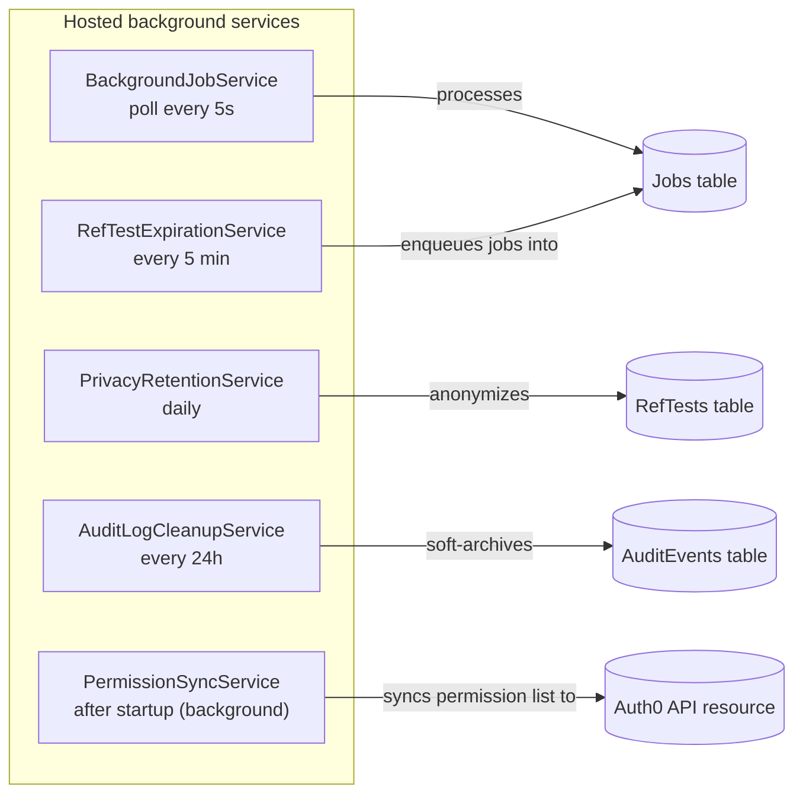
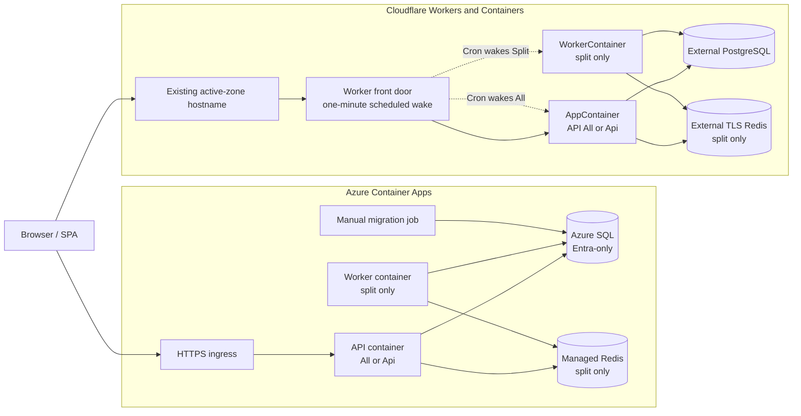
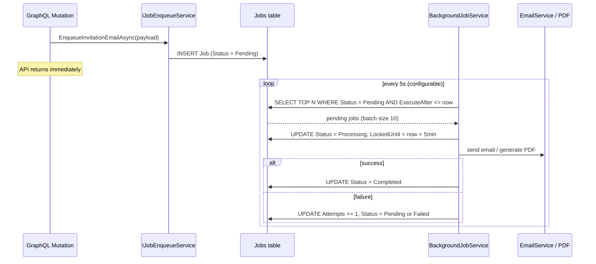
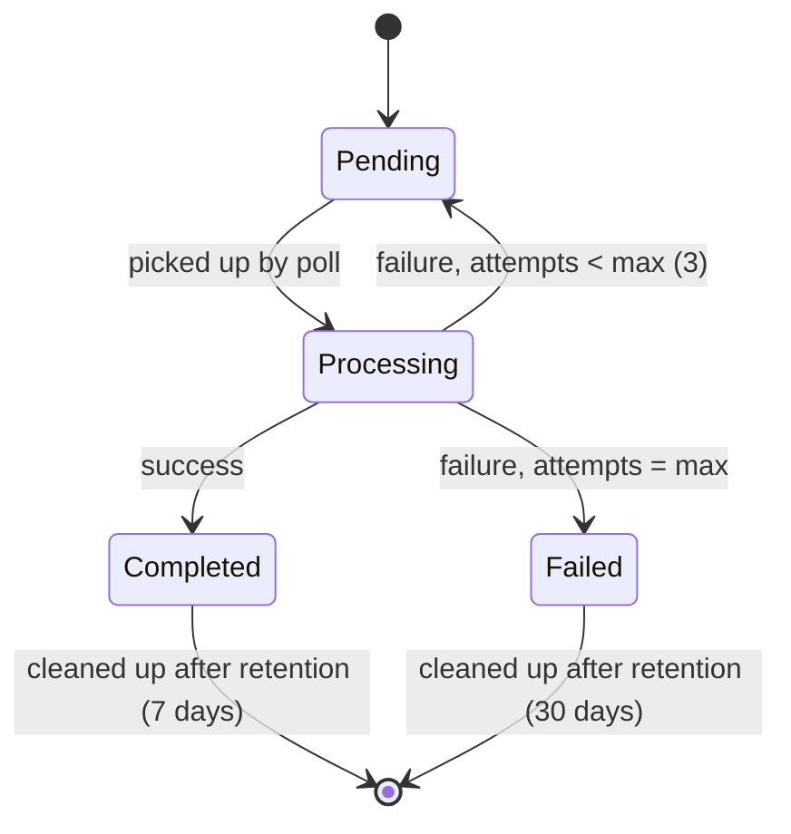
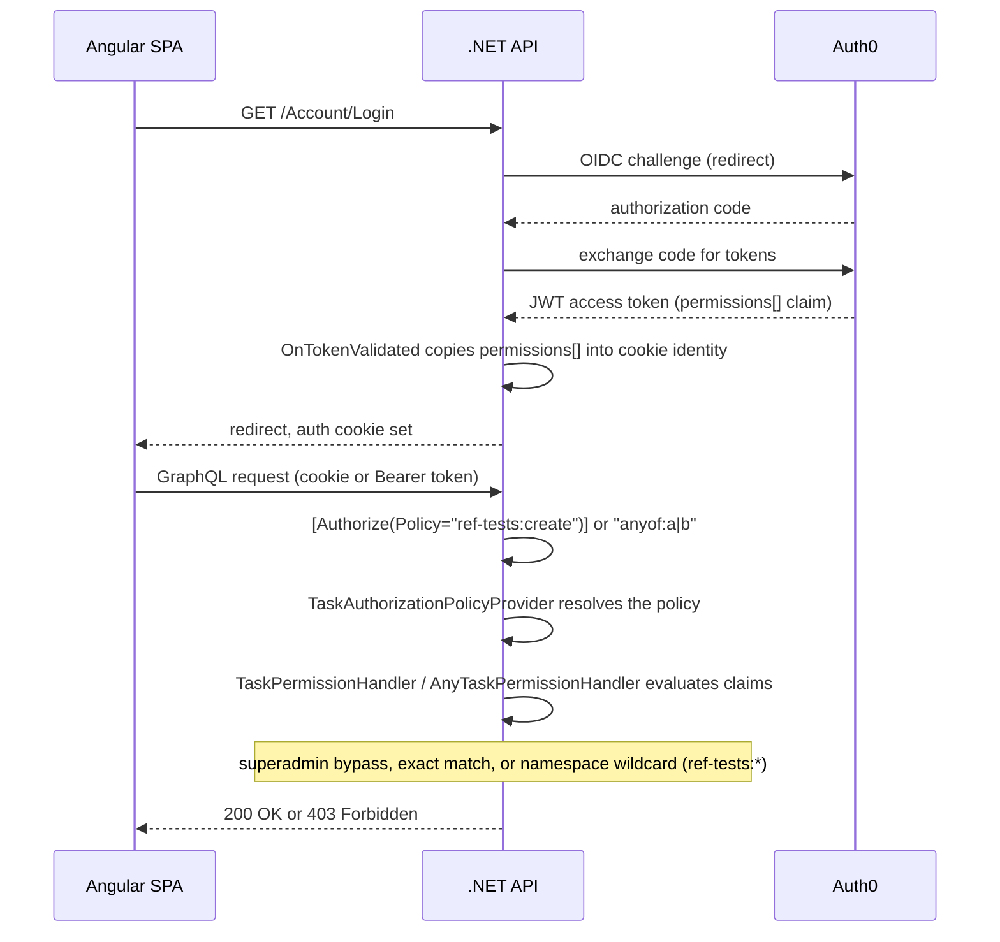
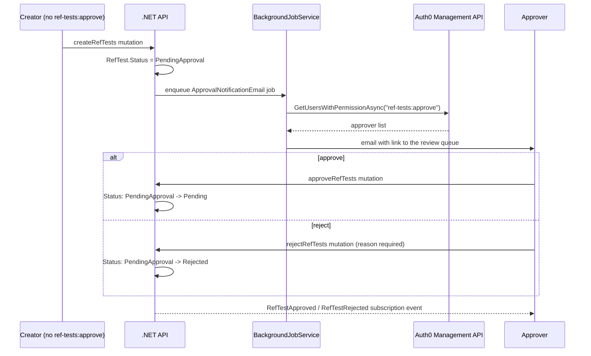
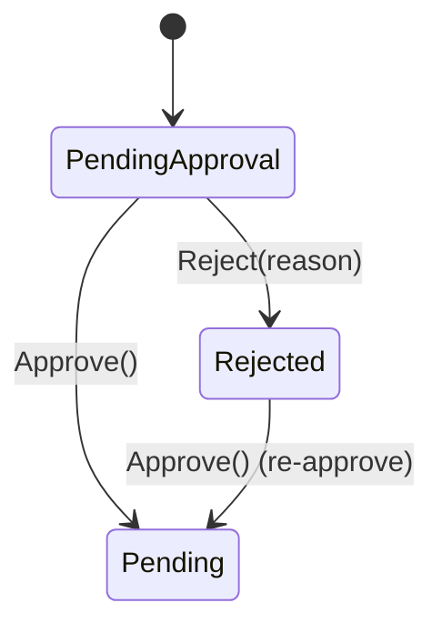

# Architecture Diagrams

Detailed flow diagrams for the background services and authorization system referenced from the [README](../README.md#background-services).

## Background Services Overview

In `Hosting:Mode=All`, the five hosted services run in the API process. In split mode the API
serves HTTP while the Worker process runs them. The SQL-backed job queue is durable in both
topologies; split mode also requires shared Redis for subscriptions, participant session locks, and
privacy challenge limits.

## Container hosting topologies

`Hosting:Mode` and `State:Mode` are provider-neutral. Azure maps them to Container Apps; Cloudflare
maps them to a Worker and Durable Object Containers. `All` keeps API and background services
together. Split mode runs the API and Worker separately and requires shared state.

Azure and Cloudflare are alternative hosting targets, not a single shared deployment. Azure
Terraform owns Azure infrastructure while GitHub release workflows own image rollout. Cloudflare
Terraform owns R2 state and the custom-domain binding; Wrangler owns Worker code, Container images,
Cron, and runtime secrets. See [the deployment guide](DEPLOYMENT.md).

## Job Queue Flow (`BackgroundJobService`)

### Job Status Lifecycle

## Authentication & Authorization Flow

See [SECURITY.md](SECURITY.md) for the full permission reference and Auth0 setup.

## Approval Workflow

